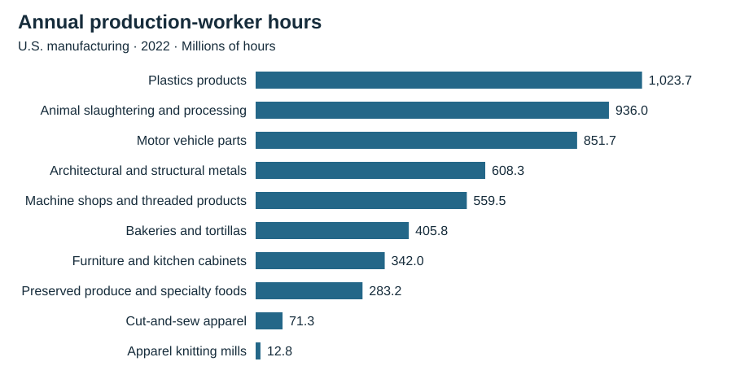

# trace-unseen

## Task discovery pilot

Run `npm install` then `npm run research` to research injection-molding tasks with
a custom TypeScript OpenCode SDK agent, Tavily tools, and SQLite persistence.
Customize agents in `src/agents/index.ts`; press F5 in VS Code to debug the job.
See [job setup and outputs](docs/task-discovery-job.md).

## Human labor in U.S. manufacturing

These charts compare ten selected industry groups from the 2022 Economic Census. They include the five largest four-digit manufacturing groups by production-worker hours and five additional groups for comparison. Both charts use the same industries, sorted by the measure shown.

### Industry data

| U.S. manufacturing industry group | NAICS | Annual production-worker hours (millions) | Production-worker hours per $1,000 of value added | Establishments |
|---|---:|---:|---:|---:|
| Plastics product manufacturing | 3261 | 1,023.7 | 8.13 | 9,871 |
| Animal slaughtering and processing | 3116 | 936.0 | 9.71 | 3,870 |
| Motor vehicle parts manufacturing | 3363 | 851.7 | 9.41 | 4,846 |
| Architectural and structural metals manufacturing | 3323 | 608.3 | 7.87 | 14,826 |
| Machine shops, turned products, and screw, nut, and bolt manufacturing | 3327 | 559.5 | 11.27 | 22,073 |
| Bakeries and tortilla manufacturing | 3118 | 405.8 | 8.76 | 11,979 |
| Household and institutional furniture and kitchen cabinet manufacturing | 3371 | 342.0 | 12.78 | 10,113 |
| Fruit and vegetable preserving and specialty food manufacturing | 3114 | 283.2 | 6.73 | 2,052 |
| Cut-and-sew apparel manufacturing | 3152 | 71.3 | 16.25 | 3,835 |
| Apparel knitting mills | 3151 | 12.8 | 19.72 | 228 |

**Source for the table and both charts.** U.S. Census Bureau, 2022 Economic Census, *Manufacturing: Summary Statistics for the U.S., States, and Selected Geographies: 2022*. [Census table EC2231BASIC](https://data.census.gov/table/ECNBASIC2022.EC2231BASIC?q=EC2231BASIC) · [Download the underlying data (ZIP)](https://www2.census.gov/programs-surveys/economic-census/data/2022/sector31/EC2231BASIC.zip)

Across all U.S. manufacturing, production workers logged **5.57 hours per $1,000 of value added**. The hours shown above are industry totals for 2022. Estimating the share devoted to a specific task requires measurements at the worksite.

### Where are the most production hours spent?

Plastics products alone accounted for over a billion production-worker hours. To investigate a molding operation, measure how much operator time goes into removing, inspecting, and sorting parts after each machine cycle.

### Which industries use the most labor per dollar of value added?

Apparel knitting mills had the fewest total hours among these ten industries and the highest labor intensity. For a sewing operation, time fabric alignment, stitching, and rework separately to identify which subtask accounts for the labor. Industry totals alone cannot establish the hours a machine could save.

**Data and calculations.** The charts use national four-digit NAICS rows. Annual hours in millions equal `HOURS / 1,000`. Hours per $1,000 of value added equal `1,000 × HOURS / VALADD`, since Census reports both fields in thousands. The benchmark uses the national manufacturing total (NAICS 31–33).
