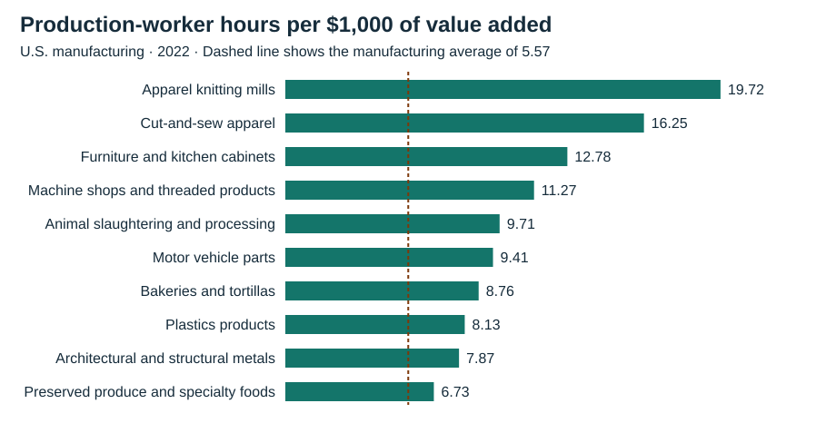

# trace-unseen

## Human labor in U.S. manufacturing

These charts compare ten selected industry groups from the 2022 Economic Census. They include the five largest four-digit manufacturing groups by production-worker hours and five additional groups for comparison. Both charts use the same industries, sorted by the measure shown.

### Where are the most production hours spent?

Plastics products alone accounted for over a billion production-worker hours. To investigate a molding operation, measure how much operator time goes into removing, inspecting, and sorting parts after each machine cycle.

### Which industries use the most labor per dollar of value added?

Apparel knitting mills had the fewest total hours among these ten industries and the highest labor intensity. For a sewing operation, time fabric alignment, stitching, and rework separately to identify which subtask accounts for the labor. Industry totals alone cannot establish the hours a machine could save.

**Data and calculations.** The charts use national four-digit NAICS rows. Annual hours in millions equal `HOURS / 1,000`. Hours per $1,000 of value added equal `1,000 × HOURS / VALADD`, since Census reports both fields in thousands. The benchmark uses the national manufacturing total (NAICS 31–33). [2022 Economic Census table EC2231BASIC](https://data.census.gov/table/ECNBASIC2022.EC2231BASIC) · [Download the source data](https://www2.census.gov/programs-surveys/economic-census/data/2022/sector31/EC2231BASIC.zip)
