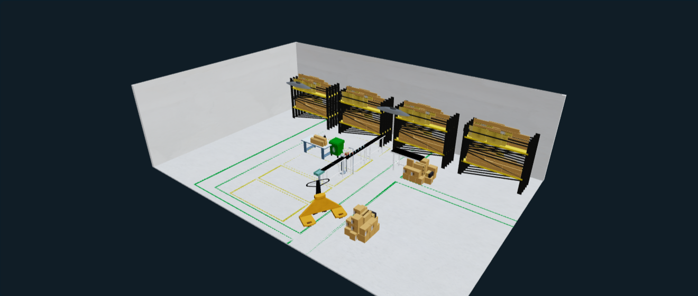
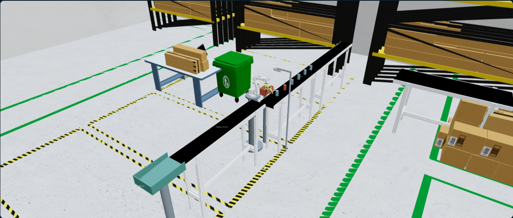
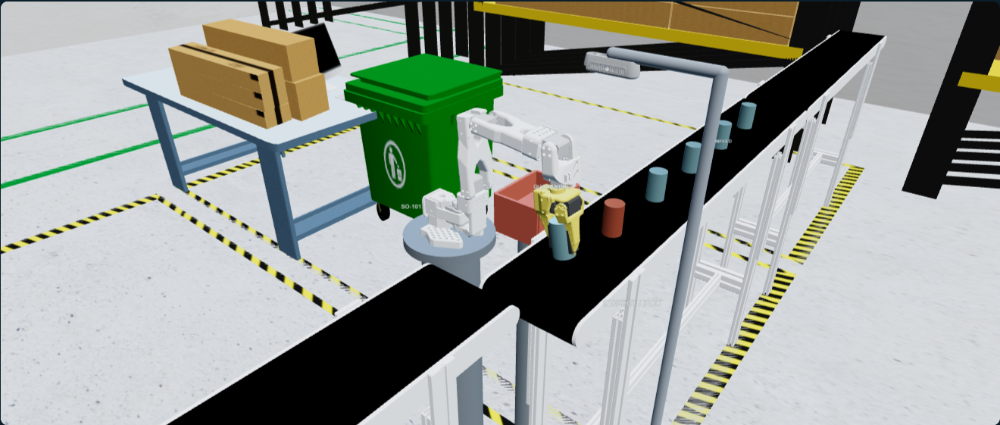
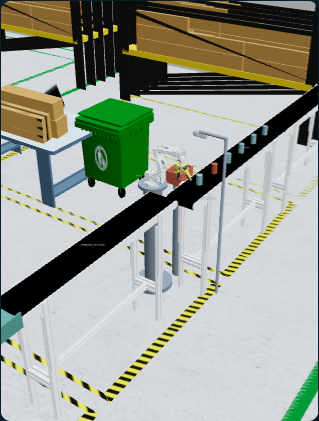

# Live factory screenshots

Captured from the local running app with Playwright. Desktop viewport: 1440 × 1000;
mobile viewport: 390 × 844. Images show the rendered canvas, with assets loaded.
The six-can batch is ready in the overview shots; the robot close-up is paused
at the start of the lift phase after bilateral finger contact was verified.

## Factory floor

## Six-can workcell

## Robot grasp

## Mobile workcell

